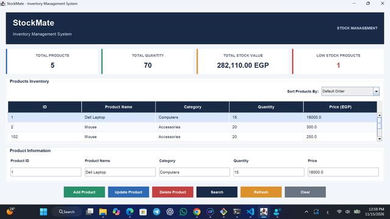

# StockMate

**StockMate** is a desktop inventory management application built with **Java Swing** and **SQLite**.

It provides a simple graphical interface for managing product records, tracking inventory quantities, and monitoring stock levels while storing data locally in an SQLite database.

## Application Preview



## Features

- **Product Management (CRUD):** Add, view, update, and delete products.
- **Search:** Find products by name or category.
- **Sorting:** Sort products by ID, name, quantity, or price in ascending or descending order.
- **Dashboard:** View total products, total quantity, total stock value, and low-stock product count.
- **Low-Stock Highlighting:** Products with a quantity of 5 or less are highlighted in the inventory table.
- **Local Database:** Product data is stored in SQLite.
- **Legacy Data Import:** Imports existing records from `data/products.txt` once, when the file is available and the database has not already completed the import.

## Tech Stack

- Java (JDK 17 or later recommended)
- Java Swing
- SQLite
- SQLite JDBC Driver (`lib/sqlite-jdbc-3.54.1.0.jar`)

## Project Structure

```text
StockMate/
├── assets/
│   └── stockmate-dashboard.png
├── lib/
│   └── sqlite-jdbc-3.54.1.0.jar
├── src/
│   ├── Main.java
│   ├── TestProductManager.java
│   ├── controller/
│   │   └── ProductManager.java
│   ├── database/
│   │   ├── DatabaseConnection.java
│   │   └── ProductStorage.java
│   ├── model/
│   │   └── Product.java
│   └── view/
│       └── MainFrame.java
├── data/                 # Created locally at runtime
├── out/                  # Generated compiled classes
└── .gitignore
```

## Requirements

- Windows, macOS, or Linux
- JDK 17 or later
- SQLite JDBC driver (included in the `lib` directory)

## Run on Windows (PowerShell)

Run the following commands from the project root directory.

### 1. Compile the Application

```powershell
javac -cp "lib\sqlite-jdbc-3.54.1.0.jar" -d out src\Main.java src\model\Product.java src\database\DatabaseConnection.java src\database\ProductStorage.java src\controller\ProductManager.java src\view\MainFrame.java
```

### 2. Launch StockMate

```powershell
java -cp "lib\sqlite-jdbc-3.54.1.0.jar;out" Main
```

The application initializes the SQLite database automatically. The database is created locally at `data/stockmate.db`.

## Data and Privacy

The local `data/` directory and compiled `out/` directory are excluded from Git through `.gitignore`.

Your local database and inventory records are therefore not included in this repository by default.

## Current Project Status

StockMate is an actively developed learning and portfolio project. Features and documentation may change as development continues.

## Author

**Ibrahim Ahmed**

---

If you find a bug or have a suggestion, feel free to open an issue in the repository.